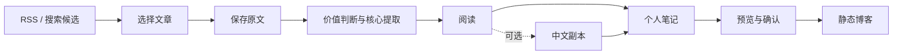

# PracShelf

PracShelf 是本地文章阅读与笔记工具。支持 AI 实践资料筛选、核心提取、中英对照和 Markdown 导出。

## 功能

- RSS 收件箱显示标题、简介、作者和日期。文章可保存或忽略。
- 采集模块保存原始响应和正文版本。旧版本保留。
- 模型在一次任务中判断阅读价值并提取核心内容。提取结果附原文引文。
- 翻译按需执行。阅读页支持原文、中文和左右对照。
- 阅读页和笔记博客提供章节目录。
- 流程页显示阶段状态、输入、结果和错误。失败阶段可单独重试。
- 调用记录显示输入、缓存读取、输出 tokens 和耗时。完整日志按需加载。
- 阅读旁可展开笔记区。支持 Markdown 预览、草稿恢复、历史版本、导出和静态博客构建。
- 备份包含数据库和文件产物。恢复时校验路径、哈希和数据库完整性。

RSS 刷新、原文采集和旧结果读取不调用模型。

## 流程



处理阶段由用户启动。已完成结果按原文版本复用。历史记录保留当时的模型配置。

## 技术栈

| 技术 | 用途 |
| --- | --- |
| Python / FastAPI | 接口、阶段执行和状态查询 |
| SQLite / 本地文件 | 来源、正文版本、任务和文件产物 |
| httpx / feedparser / trafilatura | 网页请求、RSS 解析和正文提取 |
| Codex Python SDK | 搜索、价值判断、核心提取和翻译 |
| LangChain `StructuredTool` | 搜索工具封装 |
| 可选 `ChatDeepSeek` | DeepSeek 接入 |
| Astro / TypeScript | 工作台页面和静态博客 |

## 启动

需要 Python 3.12+ 和 [uv](https://docs.astral.sh/uv/)。

```powershell
git clone https://github.com/hirovel/pracshelf.git
cd pracshelf
uv sync --locked --no-dev
uv run --no-dev collect serve
```

设置页地址为 `http://127.0.0.1:8766/setup`。

模型任务使用用户自己的 Codex 账号和额度。设置页提供连接检查和官方登录入口。已有登录可复用。

默认配置为 `gpt-6.1-sol / high`。可用模型以账号目录为准。官方文档见 [登录](https://learn.chatgpt.com/docs/auth) 和 [Python SDK](https://learn.chatgpt.com/docs/codex-sdk)。

未登录时可打开 `/setup/demo`。演示使用合成数据。

服务监听 `127.0.0.1`。资料默认保存在 `data/`。关闭终端后服务停止。

```powershell
# 指定端口
uv run --no-dev collect serve --no-browser --port 8767

# 指定资料目录
uv run --no-dev collect --data-dir data/my-library serve
```

### 前端与博客

仓库包含编译后的工作台页面。修改前端或构建博客需要 Node.js 22.12+。

```powershell
cd frontend
npm ci
npm run build
```

FastAPI 提供工作台页面和数据。博客通过网页构建。构建输入为用户确认的笔记快照。产物在本机预览。

公开快照包含选定的个人笔记和来源链接。完整原文、译文和模型日志保留在私有库。

### 备份与恢复

以下命令在项目根目录执行。备份期间不能有运行中的任务。备份和恢复目标须为新目录。

```powershell
uv run --no-dev collect --data-dir data backup backups/my-backup
uv run --no-dev collect restore backups/my-backup --into data/restored-library
uv run --no-dev collect --data-dir data/restored-library serve --port 8767
```

备份包含 SQLite 和持久文件。凭据和密钥不进入备份。

### DeepSeek

```powershell
uv sync --locked --extra deepseek --no-dev
```

密钥配置项为 `DEEPSEEK_API_KEY` 或本机 `data/deepseek-api-key.txt`。提供方在模型设置中选择。调用失败不会自动切换提供方。

## 代码

| 模块 | 文件 |
| --- | --- |
| 网页采集与正文提取 | [collector.py](src/learning_library/collector.py)、[pipeline.py](src/learning_library/pipeline.py) |
| 候选与 RSS | [candidates.py](src/learning_library/candidates.py)、[inbox.py](src/learning_library/inbox.py) |
| 核心与翻译 | [article_insights.py](src/learning_library/article_insights.py)、[translation.py](src/learning_library/translation.py) |
| 模型与搜索 | [codex_model.py](src/learning_library/codex_model.py)、[searches.py](src/learning_library/searches.py) |
| 阅读与笔记 | [library.py](src/learning_library/library.py)、[curation.py](src/learning_library/curation.py) |
| 快照与博客构建 | [publication.py](src/learning_library/publication.py)、[reading_builds.py](src/learning_library/reading_builds.py) |
| 备份与流程状态 | [library_backup.py](src/learning_library/library_backup.py)、[workflow_view.py](src/learning_library/workflow_view.py) |

内部 Python 包名为 `learning_library`。命令为 `collect`。

## 测试

```powershell
uv sync --locked
uv run pytest -q
uv run ruff check src tests examples/curation_demo.py
node --test frontend/scripts/publish.test.mjs frontend/src/scripts/navigation-context.test.mjs frontend/src/scripts/library-view.test.mjs frontend/src/scripts/presentation.test.mjs frontend/reading/markdown.test.mjs frontend/reading/snapshots.test.mjs
```

测试使用隔离目录和模拟模型。覆盖版本绑定、重复提交、失败重试、引文定位、笔记导出、快照隔离、构建和备份恢复。

## 当前限制

- 当前版本供本地单人使用。工作台没有远程访问鉴权。
- 运行需要完整源码目录。单独 wheel 不包含博客构建源码。
- 采集支持公开文字网页。登录页面、PDF 和视频转录暂不支持。
- 首次登录流程尚未在另一台未登录机器上验证。
- 引文校验只检查文本来源。总结和译文仍可能有语义错误。
- 缺失的实际模型、底层请求数和用量显示为未知。
- 本地结果复用和供应商缓存分别记录。供应商缓存命中没有保证。
- 服务重启可能中断任务。通用任务恢复尚未完成。
- 博客尚未部署。RAG 和定时研究尚未实现。

## 第三方许可

来源和许可见 [THIRD_PARTY_NOTICES.md](THIRD_PARTY_NOTICES.md) 和 [frontend/UPSTREAM.md](frontend/UPSTREAM.md)。第三方许可声明随源码保留。新增代码的统一开源许可证尚未选择。
