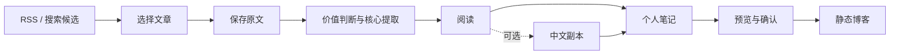

# PracShelf

本地 AI 实践资料库。

支持文章采集、核心提取、中英对照阅读、Markdown 笔记和静态博客构建。

A local library for AI practice articles and Markdown notes.

## 功能

- 从 RSS 读取标题、简介、作者和日期。用户选择保存或忽略。
- 保存原始响应和正文版本。旧版本保留。
- 用一次模型任务判断文章价值并提取核心内容。核心内容附原文依据。
- 按需生成中文副本。阅读页支持原文、中文和左右对照。
- 显示阶段状态、输入、结果和失败原因。失败阶段可单独重试。
- 记录输入 tokens、缓存读取、输出 tokens 和耗时。完整日志按需读取。
- 保存 Markdown 笔记和历史版本。支持导出。
- 将确认后的个人笔记构建为静态博客。
- 备份数据库和文件产物。恢复时校验路径、哈希和数据库完整性。

RSS 刷新和原文采集不调用模型。查看旧结果不调用模型。

## 流程



各阶段由用户启动。已有结果按原文版本复用。历史记录保留当时的模型配置。

## 技术栈

| 技术 | 用途 |
| --- | --- |
| Python / FastAPI | HTTP 路由、阶段执行和状态查询 |
| SQLite / 本地文件 | 来源、正文版本、任务记录和文件产物 |
| httpx / feedparser / trafilatura | 网页请求、RSS 解析和正文提取 |
| Codex Python SDK | 搜索、价值判断、核心提取和翻译 |
| LangChain `StructuredTool` | 搜索工具封装 |
| 可选 `ChatDeepSeek` | DeepSeek 模型调用 |
| Astro / TypeScript | 工作台页面和静态博客 |
| Markdown | 笔记编辑、渲染和导出 |

## 启动

需要 Python 3.12+ 和 [uv](https://docs.astral.sh/uv/)。

```powershell
git clone https://github.com/hirovel/pracshelf.git
cd pracshelf
uv sync --locked --no-dev
uv run --no-dev collect serve
```

设置页地址为 `http://127.0.0.1:8766/setup`。

每位用户连接自己的 Codex 账号。已有登录可复用。首次登录使用官方浏览器流程。连接检查读取账号类别和模型目录。模型任务消耗账号额度。

默认模型配置为 `gpt-6.1-sol / high`。程序会核对账号可用的模型目录。官方文档：[登录](https://learn.chatgpt.com/docs/auth)、[Python SDK](https://learn.chatgpt.com/docs/codex-sdk)。

未登录时可打开 `/setup/demo`。演示使用合成数据。

服务监听 `127.0.0.1`。资料保存在 `data/`。关闭终端会停止服务。

```powershell
# 指定端口
uv run --no-dev collect serve --no-browser --port 8767

# 指定资料目录
uv run --no-dev collect --data-dir data/my-library serve
```

### 前端与博客

需要 Node.js 22.12+。

```powershell
cd frontend
npm ci
npm run build
```

FastAPI 提供编译后的页面和数据。

博客构建在网页完成：保存笔记、生成公开预览、确认版本、选择快照构建。生成的博客在本机预览。

公开快照包含选定的个人笔记和来源链接。完整原文、译文和模型日志保留在私有库。

### 备份与恢复

备份命令在项目根目录执行。库内不能有执行中的任务。备份和恢复目标使用新目录。

```powershell
uv run --no-dev collect --data-dir data backup backups/my-backup
uv run --no-dev collect restore backups/my-backup --into data/restored-library
uv run --no-dev collect --data-dir data/restored-library serve --port 8767
```

备份包含 SQLite 和持久文件。凭据和密钥不进入备份。

### DeepSeek

```powershell
uv sync --locked --extra deepseek --no-dev
```

密钥通过 `DEEPSEEK_API_KEY` 或本机 `data/deepseek-api-key.txt` 配置。在模型设置中选择 DeepSeek。模型失败不会自动切换提供方。

## 代码

| Module | 文件 |
| --- | --- |
| 网页采集与正文提取 | [collector.py](src/learning_library/collector.py)、[pipeline.py](src/learning_library/pipeline.py) |
| 候选与 RSS | [candidates.py](src/learning_library/candidates.py)、[inbox.py](src/learning_library/inbox.py) |
| 核心与翻译 | [article_insights.py](src/learning_library/article_insights.py)、[translation.py](src/learning_library/translation.py) |
| 模型与搜索 | [codex_model.py](src/learning_library/codex_model.py)、[searches.py](src/learning_library/searches.py) |
| 阅读与笔记 | [library.py](src/learning_library/library.py)、[curation.py](src/learning_library/curation.py) |
| 快照与博客构建 | [publication.py](src/learning_library/publication.py)、[reading_builds.py](src/learning_library/reading_builds.py) |
| 备份与流程状态 | [library_backup.py](src/learning_library/library_backup.py)、[workflow_view.py](src/learning_library/workflow_view.py) |

内部 Python 包名为 `learning_library`。命令为 `collect`。

## 测试

```powershell
uv sync --locked
uv run pytest -q
uv run ruff check src tests examples/curation_demo.py
node --test frontend/src/scripts/navigation-context.test.mjs frontend/src/scripts/library-view.test.mjs frontend/reading/markdown.test.mjs frontend/reading/snapshots.test.mjs
```

测试使用隔离目录和模拟模型调用。测试覆盖版本绑定、重复提交、失败重试、引文定位、笔记导出、快照隔离、构建和备份恢复。

## 当前限制

- 当前版本为本地单人 MVP。工作台没有远程登录鉴权。
- 安装需要完整源码目录。单独 wheel 不包含博客构建源码。
- 支持公开文字网页。需登录的动态页面、PDF 和视频转录暂未支持。
- 首次未登录账号在另一台机器上的登录路径待验证。
- 引文定位校验通过仍需核对总结语义。翻译结构校验通过仍需核对译文。
- 缺失的实际执行模型、底层请求数和用量字段显示为未知。
- 结果复用与供应商缓存分别记录。缓存命中由供应商决定。
- 服务重启可能中断任务。通用任务恢复待完善。
- 博客尚未部署。RAG 和定时研究尚未实现。

## 第三方许可

来源和许可见 [THIRD_PARTY_NOTICES.md](THIRD_PARTY_NOTICES.md) 与 [frontend/UPSTREAM.md](frontend/UPSTREAM.md)。前端保留 Astro Cactus、Maxime Heckel、字体和 Prism 的许可声明。新增代码的统一开源许可证尚未选择。
