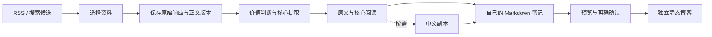

# PracShelf

**AI 实践资料库：保存原文、阅读核心内容与中文对照，整理自己的 Markdown 笔记。**

A local workbench for collecting AI development articles, reading source-linked insights, and turning personal notes into a static blog.

PracShelf 面向个人阅读和知识积累。先从 RSS 或搜索候选中选择资料，再保存原文；价值判断与核心提取使用一次模型任务，完整中文副本按需生成。原文、机器结果和个人笔记分别保存。

当前为本地单人 MVP，服务只监听 `127.0.0.1`。仓库不包含开发者的资料库、账号、密钥、个人笔记或模型运行日志。

## 功能

- **收集资料**：RSS 候选展示标题、简介、作者与日期，支持保存或忽略。RSS 刷新和原文保存不调用模型；网页搜索是明确启动的模型或搜索工具任务。
- **保存来源**：保留原始响应、正文和内容版本；同一来源的新版不会覆盖旧版。
- **价值与核心**：一次全文请求生成阅读建议、分类和带原文依据的核心内容；本地校验结构与引文定位。引文匹配不等于总结语义已验证。
- **中文阅读**：原文、中文或左右对照；中文副本可选，分批记录进度，继续未完成批次时复用已保存结果。
- **流程与记录**：固定步骤展示输入、结果、失败原因和允许动作。历史用量、缓存读取 tokens 与执行耗时分别呈现，完整日志按需读取。
- **个人笔记**：Markdown 编辑、版本历史与导出；正文由使用者编写，不自动冒充个人理解。
- **静态博客**：在网页预览并确认自己的笔记版本，再构建独立 Astro 阅读站。公开快照不包含第三方完整原文、译文或模型日志。
- **备份恢复**：SQLite 与持久文件一起保存，校验路径、大小、SHA256 和数据库完整性；不复制凭据，不覆盖已有目录。

## 处理流程



切换页面和查看旧结果不会执行模型。各阶段由使用者明确启动；已有兼容结果直接读取，失败后只重试对应工作。记录绑定原文版本，模型配置变更不会改写历史任务配置。

## 技术实现

| 技术 | 实际职责 |
| --- | --- |
| Python / FastAPI | 本地 HTTP Interface、流程执行与状态查询 |
| SQLite / 文件产物 | 元数据、版本和任务记录；原始响应与 SDK 日志独立存储 |
| httpx / feedparser / trafilatura | 网页请求、RSS 解析与正文提取 |
| Codex Python SDK | 默认搜索、全文判断与核心提取、可选中文副本；使用每位使用者自己的官方账号 |
| LangChain `StructuredTool` | 封装搜索工具及固定输入，不负责整条流程编排 |
| 可选 `ChatDeepSeek` | 手动选择的模型 Adapter，不自动转付费 API |
| Astro / TypeScript / Markdown | 本地应用页面、独立博客构建与 Markdown 安全渲染 |

## 本地运行

需要 Python 3.12+ 和 [uv](https://docs.astral.sh/uv/)。默认安装使用锁定依赖，不要求先配置 API key。

```powershell
git clone https://github.com/hirovel/pracshelf.git
cd pracshelf
uv sync --locked --no-dev
uv run --no-dev collect serve
```

浏览器打开 `http://127.0.0.1:8766/setup`。已有 Codex 官方登录可复用；首次连接通过官方浏览器流程完成。连接检查只读取登录类别与模型目录，不创建模型任务。模型任务使用账号额度；本项目不提供共享订阅或免费无限调用，不自动转 API。

官方 [Codex 登录说明](https://learn.chatgpt.com/docs/auth)、[Python SDK](https://learn.chatgpt.com/docs/codex-sdk)。默认新任务配置为 `gpt-6.1-sol / high`，执行前核对本机模型目录，不自动替换。配置名称与供应商实际执行模型的证据分别记录。

未登录时可打开 `/setup/demo` 查看合成只读演示。新资料库为空，不会导入开发者的文章或笔记。读取已有资料不需要执行模型。

```powershell
# 不自动打开浏览器；指定其他端口
uv run --no-dev collect serve --no-browser --port 8767

# 将不同资料库放在已忽略的 data 目录下
uv run --no-dev collect --data-dir data/my-library serve
```

关闭终端会停止服务。数据默认保存在 `data/`，使用者应自行备份；源码上传不包含该目录。

### 前端修改与博客构建

普通阅读与笔记使用随源码提供的编译页面。前端修改、博客构建还需要 Node.js 22.12+：

```powershell
cd frontend
npm ci
npm run build
```

构建后刷新页面即可，FastAPI 继续提供页面与数据，无需另开 Astro 服务。设置页和博客构建页会说明缺少的程序或依赖。

在阅读页保存自己的笔记，进入“公开预览”核对正文和可选摘录，亲自确认这一版，再在“构建结果”中选择快照构建。输出在本机预览，尚无自动互联网部署。

### 备份与恢复

在项目根目录执行。备份时库内不能有正在执行的任务，目标目录必须是新目录。

```powershell
uv run --no-dev collect --data-dir data backup backups/my-backup
uv run --no-dev collect restore backups/my-backup --into data/restored-library
uv run --no-dev collect --data-dir data/restored-library serve --port 8767
```

恢复包含数据库、原文与运行产物，不包含账号凭据或 API key。完整源码目录是当前支持的安装方式；单独 wheel 不包含博客构建源码。

### 可选 DeepSeek

```powershell
uv sync --locked --extra deepseek --no-dev
```

密钥配置在服务环境变量 `DEEPSEEK_API_KEY`，或本机 `data/deepseek-api-key.txt`；然后在模型设置中明确选择 DeepSeek。超时、额度耗尽或登录失败不会自动启用它。

## 代码入口

| Module | 位置与职责 |
| --- | --- |
| 收集与正文 | [collector.py](src/learning_library/collector.py)、[pipeline.py](src/learning_library/pipeline.py)：获取、持久保存与提取 |
| 候选与 RSS | [candidates.py](src/learning_library/candidates.py)、[inbox.py](src/learning_library/inbox.py)：选择、去重与候选状态 |
| 核心与中文 | [article_insights.py](src/learning_library/article_insights.py)、[translation.py](src/learning_library/translation.py)：固定输入、复用与执行记录 |
| 模型与搜索 | [codex_model.py](src/learning_library/codex_model.py)、[searches.py](src/learning_library/searches.py)：SDK 调用与搜索工具封装 |
| 阅读与笔记 | [library.py](src/learning_library/library.py)、[curation.py](src/learning_library/curation.py)：版本选择与笔记历史 |
| 公开与构建 | [publication.py](src/learning_library/publication.py)、[reading_builds.py](src/learning_library/reading_builds.py)：字段白名单、快照与本地博客构建 |
| 恢复与状态 | [library_backup.py](src/learning_library/library_backup.py)、[workflow_view.py](src/learning_library/workflow_view.py)：文件一致性与只读状态投影 |

产品与发行名称为 PracShelf；内部 Python 包 `learning_library` 和 `collect` 命令保留兼容。

## 检查

```powershell
uv sync --locked
uv run pytest -q
uv run ruff check src tests examples/curation_demo.py
node --test frontend/src/scripts/navigation-context.test.mjs frontend/src/scripts/library-view.test.mjs frontend/reading/markdown.test.mjs frontend/reading/snapshots.test.mjs
```

Python 行为测试使用隔离目录和模拟模型/网络，不消耗账号推理额度。既有检查覆盖版本绑定、重复提交、失败重试、引文定位、笔记导出、公开字段隔离、构建和备份恢复。测试通过不能证明真实文章推荐或翻译语义准确率。

## 已知范围

- 当前为本地单人应用，没有远程后台鉴权，不应把工作台直接暴露到公网。
- 支持公开文字网页；需登录的动态站点、PDF、视频转录不属于当前主路径。
- 完整中文副本已在真实资料上跑通；首次未登录账号在另一台机器上的登录路径仍待验证。
- SDK 底层请求数、实际执行模型与用量字段缺失时显示未知。结果复用与供应商前缀缓存分别处理，不承诺缓存命中。
- 服务重启可能中断处理任务；失败重试由使用者明确启动，通用任务中断恢复仍待完善。
- 尚未实现 RAG、自动定时研究或 NotebookLM 能力对照。

## 第三方来源

前端保留 Astro Cactus 与 Maxime Heckel 设计适配的来源和许可，字体与 Prism 许可随软件提供。具体范围见 [THIRD_PARTY_NOTICES.md](THIRD_PARTY_NOTICES.md) 和 [frontend/UPSTREAM.md](frontend/UPSTREAM.md)。本仓库尚未为新增代码选择统一开源许可证。
